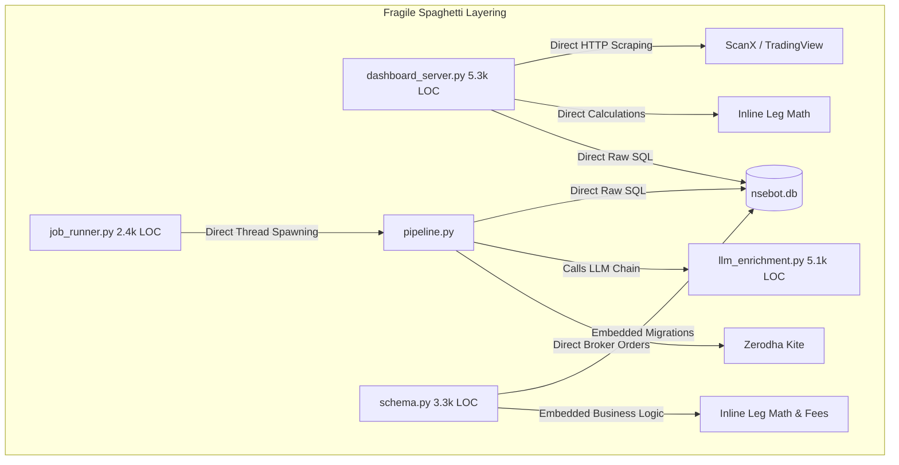
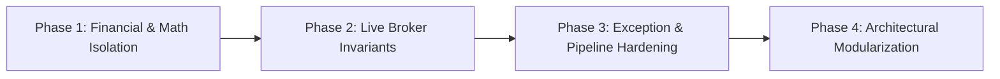

# Comprehensive Technical, Architectural & Logical Audit: NSEBOT
**Audited Subsystems:** Engine, Fetchers, Models/Persistence, Dashboard Server, Scheduler, Risk & Broker Integration  
**Date of Audit:** October 2026  
**Auditor Classification:** Principal Autonomous Systems Architect / Advisory Review  

---

## 1. Executive Summary

### 1.1 Overview & System Health
NSEBOT is an algorithmic trading system designed for Indian derivative markets (NSE/BSE equity index options, stock derivatives, and MCX commodity options). The application features multi-timeframe analysis (3H entry timing, 1H exit timing), option chain processing, AI/LLM narrative enrichment with fallback routing chains, multi-leg execution (Strangles, Straddles, Spreads, Iron Condors), and automated lifecycle management.

**Overall System Health Rating: POOR (HIGH RISK / UNFIT FOR LIVE CAPITAL)**  
While the bot features sophisticated quantitative concepts, mathematical edge definitions, and extensive rule layers, **the implementation currently suffers from architectural fragmentation, duplicate financial accounting logic, silent exception swallowing, and concurrency race conditions.** 

### 1.2 Risk Posture
Connecting this application to a live broker account under current market conditions exposes the operator to severe financial, operational, and regulatory hazards. The most critical vulnerabilities are:
1. **Split-Brain Financial Math:** Position Mark-to-Market (MTM) and realized P&L calculations are duplicated across at least 4 independent modules ([schema.py](file:///c:/Users/manve/VibeProjects/NSEBOT/src/models/schema.py), [dashboard_server.py](file:///c:/Users/manve/VibeProjects/NSEBOT/dashboard_server.py), [multileg_paper_trading.py](file:///c:/Users/manve/VibeProjects/NSEBOT/src/engine/multileg_paper_trading.py), and [multileg_pnl.py](file:///c:/Users/manve/VibeProjects/NSEBOT/src/engine/multileg_pnl.py)). Inaccuracies in rolled leg accounting recently resulted in a **+227% phantom P&L overstatement** (+₹2,36,250 displayed vs +₹72,187 actual).
2. **Silent Failure Culture:** Over **174 swallowed exceptions** (`except Exception: pass`) exist in core code paths (82 in `src/engine/`), masking critical data fetch failures, order state desyncs, and network drops.
3. **Partial-Fill & Broker Desync Hazards:** In live execution, atomic multi-leg orders are executed sequentially via REST calls. A rejected leg leaves unprotected naked options in live accounts without an immutable, crash-safe state machine.
4. **Data Sourcing Fragility:** Multiple core data fetchers rely on non-deterministic web scrapers, DOM parsers, and unofficial API endpoints prone to silent IP rate-limiting and layout changes.

---

## 2. Technical Findings

### 2.1 Codebase Metrics & Bloat
- **Core Codebase Size:** 73,726 lines across 125 Python files.
- **Monolithic Anti-Patterns:**
  - `dashboard_server.py`: 5,389 lines (FastAPI routes mixed with raw SQL, HTML/JS injection, market data fetching, and business logic).
  - `src/engine/llm_enrichment.py`: 5,166 lines (prompt construction, HTTP fallback cascades, regex parsers, token budgets).
  - `src/models/schema.py`: 3,339 lines (DDL migrations, database connection wrappers, raw CRUD operations, and trade accounting formulas).
  - `src/engine/live_trading.py`: 3,105 lines (broker API integration, position monitors, and order generators).

### 2.2 Critical Code-Level Bugs & Anti-Patterns
1. **Silent Exception Swallowing (`except Exception: pass`):**
   - 82 locations in `src/engine/` discard runtime errors without logging or metric increments.
   - Example in [time_guards.py#L196](file:///c:/Users/manve/VibeProjects/NSEBOT/src/engine/time_guards.py#L196): An unexpected exception causes the function to return `True, ""` (allowing trade entry during dangerous cutoff windows instead of failing closed).
2. **Duplicate P&L Formula Inconsistencies:**
   - Realized multi-leg trade closing in [schema.py#L2695](file:///c:/Users/manve/VibeProjects/NSEBOT/src/models/schema.py#L2695) deducts transaction costs (brokerage, STT, turnover charges), whereas MTM calculations in [dashboard_server.py#L1404-L1439](file:///c:/Users/manve/VibeProjects/NSEBOT/dashboard_server.py#L1404-L1439) ignore transaction costs entirely. Realized equity and floating equity operate under different accounting regimes.
3. **Database Concurrency & WAL Contention:**
   - SQLite is utilized as the central data store across multiple long-running threads (Scheduler, Dashboard Server, News Worker, Spark Feed Poller).
   - Write lock contention occurs under high scan frequencies when background tasks attempt concurrent WAL checkpoint writes. Read connections in `dashboard_server.py` require defensive `?mode=ro` fallbacks because write locks stall API responses.
4. **Hardcoded Fallback Credentials & Tokens:**
   - [llm_enrichment.py#L3165-L3170](file:///c:/Users/manve/VibeProjects/NSEBOT/src/engine/llm_enrichment.py#L3165-L3170) hardcodes dummy API tokens (`"omnirouter_local"`, `"opencode_free"`, `"antigravity_auto"`) directly into source logic when environment variables are missing.
5. **SQL Dynamic Formatting:**
   - 6 occurrences of string interpolation (`f"..."`) inside SQL statements ([history_analyzer.py#L247](file:///c:/Users/manve/VibeProjects/NSEBOT/src/intelligence/history_analyzer.py#L247), [schema.py#L2350](file:///c:/Users/manve/VibeProjects/NSEBOT/src/models/schema.py#L2350)). While internal column names are currently filtered, using f-strings in queries violates parameterized query standards.

---

## 3. Architectural Findings

### 3.1 Tight Coupling & Missing Layering

- **Presentation Layer Leaks:** `dashboard_server.py` performs raw database writes, parses market data snapshots, and computes complex option payoff math.
- **Data Access Layer Leaks:** `schema.py` contains business logic, trading fee calculations, and trade resolution state logic rather than strictly managing persistence and schema models.
- **God Modules:** Subsystems lack dependency injection. Modules import each other dynamically inside function bodies (`from src.engine... import ...`) to avoid circular import errors caused by monolithic file designs.

### 3.2 State Management & Concurrency Deficits
- **In-Memory Volatile State:** Key engine locks, cycle counters, and scan trackers reside in process memory (`global` variables in `job_runner.py` and `pipeline.py`). If the process restarts or crashes mid-cycle, all state is lost, leading to duplicate scans or missed expiry closures.
- **Non-Atomic Multi-Leg Fills:** Multi-leg options are executed as individual sequential market/limit orders. If leg 1 fills and leg 2 is rejected by the broker (e.g. margin exhaustion or freeze limits), the bot enters an undefined state. While `_rollback_placed_legs()` exists, in fast markets a rollback order can slip or fail, leaving naked risk.

---

## 4. Logical Findings

### 4.1 Trade Lifecycle & Accounting Flaws
1. **Rolled Leg Status Lifecycle:** When a strangle leg is adjusted, the closed leg status is set to `CLOSED`, but until our recent patch, queries scanning `multi_leg_trades` treated the book as a whole and queried current live LTPs for all leg strikes, ignoring the leg status.
2. **Single-Leg vs Multi-Leg Split:** Single-leg paper trades are stored in `paper_trades`, while multi-leg trades are stored in `multi_leg_trades` and `multi_leg_legs`. However, Trend Following Short Strangle (TFSS) historically placed individual entries in `paper_trades` with `leg_group_id`. This duality forces reporting queries to union across tables with different column semantics.
3. **Stale Snapshot Valuation:** If an option chain fetch fails for an active position strike, the valuation falls back to entry premium or a crude delta-spot approximation ([schema.py#L1740-L1756](file:///c:/Users/manve/VibeProjects/NSEBOT/src/models/schema.py#L1740-L1756)). Reporting artificial P&L during data blackouts masks stop-loss breaches.
4. **Autopsy Subsystem Blindspot:** [autopsy_writer.py#L38-L46](file:///c:/Users/manve/VibeProjects/NSEBOT/src/engine/autopsy_writer.py#L38-L46) queries closed trades from `paper_trades` and `live_trades`, completely ignoring `multi_leg_trades`. Since the vast majority of active trading now occurs in multi-leg strangles, the automated nightly autopsy AI never inspects multi-leg performance.

---

## 5. Risk Matrix

| Risk ID | Category | Finding Description | Severity | Impact Surface | Probability |
| :--- | :--- | :--- | :--- | :--- | :--- |
| **RSK-01** | **Financial** | Split-brain P&L calculations / Phantom profit distortion | **CRITICAL** | Portfolio MTM, Stop Loss, Risk limits | High |
| **RSK-02** | **Execution** | Sequential non-atomic leg execution risk (unhedged legs on partial fills) | **CRITICAL** | Live Broker Account | High |
| **RSK-03** | **Data** | 174 silent swallowed exceptions hiding critical network/data faults | **HIGH** | Market Data Pipeline, Sentinel, Alerts | High |
| **RSK-04** | **Architecture** | SQLite WAL locking under multi-threaded load stalling reads/writes | **HIGH** | Dashboard, Order Logging, Alerts | Medium |
| **RSK-05** | **Reliability** | Time-guard returning `True` (fail-open) on unhandled parser errors | **HIGH** | Trade Entry Timing, Expiry Cutoffs | Medium |
| **RSK-06** | **Maintainability** | God files (`dashboard_server.py`, `llm_enrichment.py` > 5k lines) | **MEDIUM** | Code Velocity, Regression Testing | High |
| **RSK-07** | **Observability** | Multi-leg trades excluded from automated nightly LLM autopsy analysis | **MEDIUM** | Model Feedback, Post-Mortem Analytics | High |

---

## 6. Remediation Plan

### Phase 1: Accounting Single Source of Truth (Est. Effort: Medium)
- **Target File:** Create [src/engine/accounting.py](file:///c:/Users/manve/VibeProjects/NSEBOT/src/engine/accounting.py)
- **Action:** Extract every calculation for leg P&L, book P&L, MTM, brokerage, STT, exchange turnover fees, and net realized P&L into pure, side-effect-free functions.
- **Refactor Consumers:** Deprecate inline math in [schema.py](file:///c:/Users/manve/VibeProjects/NSEBOT/src/models/schema.py), [dashboard_server.py](file:///c:/Users/manve/VibeProjects/NSEBOT/dashboard_server.py), and [multileg_paper_trading.py](file:///c:/Users/manve/VibeProjects/NSEBOT/src/engine/multileg_paper_trading.py). Every subsystem must call `calculate_leg_pnl()` and `calculate_book_pnl()`.
- **Validation:** Add deterministic unit tests verifying every combination of BUY/SELL, profit, loss, rollover, and zero LTP.

### Phase 2: Live Broker Invariant Hardening (Est. Effort: High)
- **Target Files:** [broker_gate.py](file:///c:/Users/manve/VibeProjects/NSEBOT/src/engine/broker_gate.py), [multileg_live_trading.py](file:///c:/Users/manve/VibeProjects/NSEBOT/src/engine/multileg_live_trading.py)
- **Action:**
  - Enforce two-phase commit verification on multi-leg orders:
    1. Pre-check live margin and freeze limits against official Kite Connect APIs.
    2. Place protective hedge legs before placing short legs.
    3. If short leg placement fails or rejects, immediately market-flatten the placed hedge legs and abort.
  - Fail-Closed Market Guards: Change [time_guards.py](file:///c:/Users/manve/VibeProjects/NSEBOT/src/engine/time_guards.py) outer try/except block to return `False, "Time guard exception — fail-closed"` rather than `True, ""`.

### Phase 3: Exception Audit & Resilient Ingestion (Est. Effort: Medium)
- **Target Files:** `src/engine/*.py`, `src/fetchers/*.py`
- **Action:**
  - Search and eliminate all silent `except: pass` and `except Exception: pass`. Replace with structured logging (`log.exception(...)`) and specific error handling.
  - Wire primary data ingestion to the official Zerodha Kite Connect WebSocket feed rather than HTML/DOM scrapers, utilizing the user's active high-volume free API tier.

### Phase 4: Architectural Modularization & God-File Splitting (Est. Effort: High)
- **Target Files:** `dashboard_server.py`, `src/engine/llm_enrichment.py`, `src/models/schema.py`
- **Action:**
  - Decompose `dashboard_server.py` into FastAPI Routers (`routers/paper.py`, `routers/live.py`, `routers/intelligence.py`). Move HTML templates to standard Jinja2 template files.
  - Decompose `llm_enrichment.py` into provider handlers (`providers/omnirouter.py`, `providers/groq.py`) and prompt builders.
  - Split `schema.py` into `models/tables.py`, `models/migrations.py`, and `models/database.py`.

---

## 7. Summary of Recommendations

### 7.1 Immediate Actions (Day 1 – 3)
1. **Keep Live Broker Disconnected:** Live trading must remain in shadow/disabled mode until Phase 1 and Phase 2 are complete.
2. **Fail-Closed Time Guards:** Patch [time_guards.py](file:///c:/Users/manve/VibeProjects/NSEBOT/src/engine/time_guards.py) so unhandled errors block entries instead of permitting them.
3. **Include Multi-Leg in Autopsies:** Update [autopsy_writer.py](file:///c:/Users/manve/VibeProjects/NSEBOT/src/engine/autopsy_writer.py) to audit `multi_leg_trades`.

### 7.2 Short-Term Improvements (Week 1 – 2)
1. **Centralize `accounting.py`:** Eliminate duplicate P&L formulas across the app.
2. **Kite Connect WebSocket Migration:** Connect Zerodha Kite WebSocket for sub-second live LTP ticks.
3. **Automated Regression Suite:** Implement continuous unit tests for order lifecycle and P&L math.

### 7.3 Long-Term Strategic Changes (Month 1+)
1. **Migrate to PostgreSQL / TimescaleDB:** Replace SQLite with PostgreSQL to eliminate concurrency locks between the scan engine, background workers, and dashboard server.
2. **Architectural Decoupling:** Re-layer the application into strict Domain, Infrastructure, and Presentation tiers.
